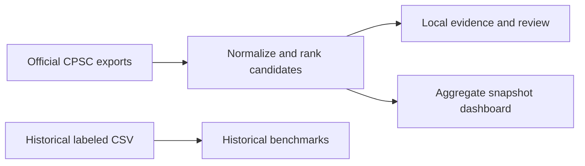

# RecallGuard V2

**NLP and record linkage for historical consumer product recall analysis**

Youssef Rafik · Based on a Southern Connecticut State University Data Science capstone

Consumer incident reports and recall listings lack a shared product ID. RecallGuard V2 ranks candidate links between official CPSC exports. Streamlit shows aggregate snapshot results and an interactive linkage example. Streamlit and FastAPI share validation and historical model inference.



## Features

Training runs offline. Candidate review is separate from supervised evaluation and inference. See the [architecture](docs/ARCHITECTURE.md) for component boundaries and the [version comparison](docs/V1_TO_V2_COMPARISON.md) for research provenance.

- **Record linkage** uses rare-token blocks, exact model codes, checksum-valid GTINs, RapidFuzz and sparse TF-IDF. The audit records evidence, date eligibility and rank.
- **ML experiments** compare Dummy, logistic regression, Linear SVM, Complement NB and XGBoost. A CPU MiniLM experiment shares a campaign-purged split with a word TF-IDF comparator.
- **Serving** combines typed single and batch predictions, DuckDB aggregates, local model contributions and eight dashboard views.

## Quick start

```bash
python3 -m venv .venv
source .venv/bin/activate
python -m pip install -r requirements-dev.txt -e .
pytest -q
streamlit run dashboard/app.py
```

The default dashboard uses bundled aggregate counts and a fictional candidate example. To inspect a newly processed snapshot, set `RECALLGUARD_SUMMARY` to its `summary.json`. Follow the [official download and processing instructions](docs/DATA_PIPELINE.md).

## Official CPSC snapshot

The raw exports provide no independently verified positive or negative outcome labels. The rebuild produces reviewable heuristic links and leaves unresolved reports unlabeled. See the [snapshot report](docs/CPSC_SNAPSHOT_REPORT.md) for measured counts, historical candidate agreement, and the evaluation decision.

## Historical benchmarks

The following held-out results were measured on the old sampled proxy labels in `training_data.csv`. Reproduction commands and holdout details are in the [historical model evaluation](docs/MODEL_EVALUATION.md).

| Held-out design | F1 | Average precision |
| --- | ---: | ---: |
| Random rows | 0.562 | 0.551 |
| Campaign-aware product groups | 0.174 | 0.123 |
| Chronological with campaign purging | 0.098 | 0.111 |

The temporal AP was below the 0.128 test positive rate. The validation-selected operating point recovered eight of 97 positives. The separate MiniLM probe improved F1 over word TF-IDF at its chosen threshold (0.233 versus 0.208), with lower AP and substantially higher CPU cost. See [V2 evaluation](docs/MODEL_EVALUATION.md) and [historical results](docs/V1_TO_V2_COMPARISON.md#historical-metric-provenance).

## Historical dashboard screenshots

[Overview from the historical dataset](screenshots/overview.png) · [Historical model performance](screenshots/model-performance.png)

## API and containers

Run `uvicorn recallguard.api:app --host 127.0.0.1` and visit `/docs` for the API schema. Run `docker compose up --build` to launch both services. The [deployment guide](docs/DEPLOYMENT.md) includes requests, model mounting and operator controls.

## Project layout

| Path | Contents |
| --- | --- |
| `src/recallguard/` | Data validation, linkage, features, training, evaluation, inference, analytics and API |
| `dashboard/` | Streamlit interface |
| `scripts/` | Optional CPU MiniLM and TF-IDF benchmark |
| `results/metrics/` | Historical and V2 aggregate experiment reports |
| `docs/` | Data terms, deployment, comparison, and limitations |
| `tests/` | Synthetic unit, API and dashboard tests |

## Interpretation

The score describes retrospective association with historical linkage labels. Candidate links require review, and incomplete records can leave a report without a link. The score does not estimate actual hazard or future recall probability. A prospective study needs publication-time snapshots, independent label adjudication and a fresh time period with mature outcomes. See [limitations](docs/LIMITATIONS.md), the [implementation report](docs/IMPLEMENTATION_SUMMARY.md), and the [MIT license](LICENSE).

Future work includes blinded review of ambiguous pairs, a mature publication-time cohort, and validation on a new period before any external deployment.
