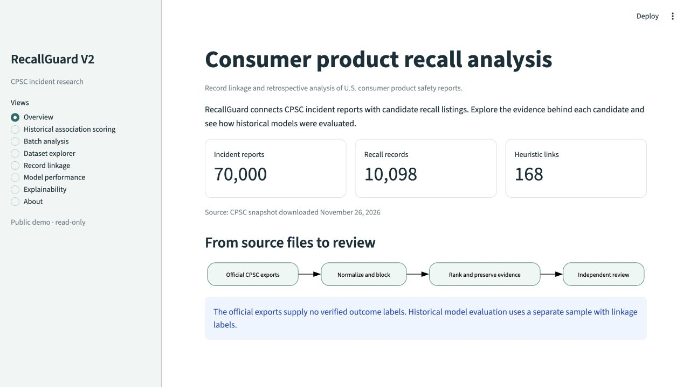
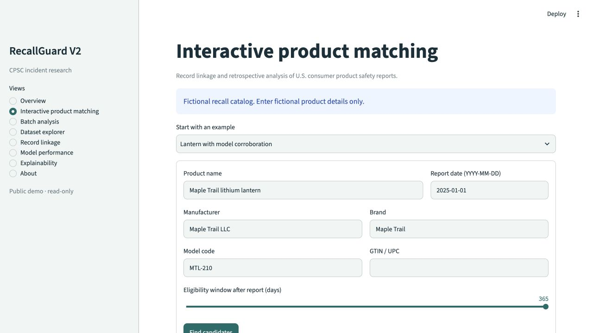
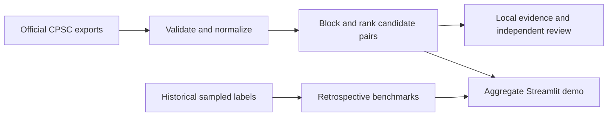

# RecallGuard V2 — Consumer Product Safety Intelligence Platform

RecallGuard connects U.S. Consumer Product Safety Commission incident reports with candidate recall listings. It preserves the matching evidence for review and shows what historical models could generalize across products and time.

[**Live demo**](https://recallguard-v2-demo.streamlit.app/) · [Source code](https://github.com/youssefrafik6/RecallGuard-V2) · [Deployment guide](docs/DEPLOYMENT.md#streamlit-community-cloud) · [Snapshot report](docs/CPSC_SNAPSHOT_REPORT.md) · [Independent review](docs/INDEPENDENT_REVIEW.md)

The hosted read-only demo shows official CPSC snapshot aggregates and historical model results. It uses a separate fictional catalog for the tools below.



## Try the fictional catalog

- **Interactive product matching** ranks candidates for a fictional report. Start from an example and adjust the product, identifiers, or date window.
- **Batch analysis** runs three sample reports or accepts a fictional CSV of up to 50 rows and 64 KiB. Download ranked results, including rows with no candidates. Uploaded text stays out of the result file.
- **Explainability** shows the linker's actual feature values, date eligibility, confidence rule, and ranking order. Scores measure similarity. The public tools require no model file.

[Fictional batch results](screenshots/public-batch-matching.jpg) · [Matching evidence](screenshots/public-linkage-explanation.jpg)



## How it works



The Python and pandas pipeline validates official files, preserves hashes, normalizes names and identifiers, and records exclusions. Linkage uses rare tokens, fuzzy name similarity, model codes, checksum-valid GTINs, and date eligibility. A unique high-confidence candidate produces a heuristic positive. Unresolved reports stay unlabeled. The system uses Streamlit for the dashboard, FastAPI for local serving, DuckDB for analytics, and scikit-learn and XGBoost for historical experiments. See the [pipeline](docs/DATA_PIPELINE.md) and [fictional linkage example](screenshots/public-linkage.jpg).

## Results and limitations

The November 26, 2026 CPSC snapshot contains **70,000 incident reports** and **10,098 retained recall listings**. The linker generated **1,231,033 candidate pairs** and **168 heuristic links**. Independent adjudication has yet to produce any verified outcomes.

| Evidence | Result |
| --- | --- |
| V2 retrospective ML | Historical proxy-label average precision was 0.551 for random rows, 0.123 for campaign-aware product groups, and 0.111 chronologically. The chronological test positive rate was 0.128. See [model evaluation](docs/MODEL_EVALUATION.md). |
| Official-export linkage | The linker surfaced 201 of 207 date-eligible reference pairs from an earlier algorithmic audit. See the [snapshot report](docs/CPSC_SNAPSHOT_REPORT.md). |
| Independent evaluation | A 200-pair review sample is ready. Review decisions and accuracy estimates are pending. See [review instructions](docs/INDEPENDENT_REVIEW.md). |

Candidate blocking can miss links. Catalog scope, sparse product identifiers, and report publication dates limit interpretation. The historical scores describe retrospective association. Prospective evaluation would require independently adjudicated outcomes, a mature follow-up period, and publication-time inputs.

## Run locally

For the read-only demo, use Python 3.13 and install only the dashboard dependencies.

```bash
python3.13 -m venv .venv
source .venv/bin/activate
python -m pip install -r dashboard/requirements.txt
streamlit run dashboard/public.py --server.address 127.0.0.1
```

For the full pipeline, local dashboard, and API, run `python -m pip install -r requirements-dev.txt -e .` and `pytest -q`. Use `uvicorn recallguard.api:app --host 127.0.0.1` and open `/docs` for the API schema. Local scoring requires a trusted historical model bundle. See the [API and Docker guide](docs/DEPLOYMENT.md).

## Author

Youssef Rafik · [MIT license](LICENSE)
