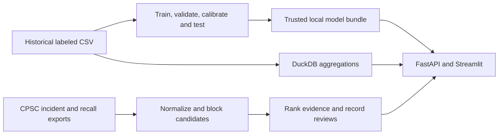

# RecallGuard V2

**Consumer Product Safety Intelligence Platform**

Youssef Rafik · Based on a Southern Connecticut State University Data Science capstone

Consumer incident reports and official recall listings lack a shared product ID. RecallGuard V2 ranks candidate links for review and evaluates how well NLP models rank historical recall associations. The local Streamlit dashboard and FastAPI API share validation and inference.



## What changed

V1 combined exploration and model fitting in a Streamlit app. V2 moves training offline, separates supervised data from candidate review, supports timed and group-aware evaluation, and serves versioned artifacts. See the [V1 audit and comparison](docs/V1_TO_V2_COMPARISON.md).

- **Record linkage** uses rare-token blocks, exact model codes, checksum-valid GTINs, RapidFuzz and sparse TF-IDF. The audit records evidence, date eligibility and rank.
- **ML experiments** compare Dummy, logistic regression, Linear SVM, Complement NB and XGBoost. A CPU MiniLM experiment shares a campaign-purged split with a word TF-IDF comparator.
- **Serving** combines typed single and batch predictions, DuckDB aggregates, local model contributions and eight dashboard views.

## Quick start

```bash
python3 -m venv .venv
source .venv/bin/activate
python -m pip install -r requirements-dev.txt -e .
pytest -q
streamlit run dashboard/app.py
```

Set `RECALLGUARD_DATA` and `RECALLGUARD_MODEL` when you have the local CSV and trusted model bundle. The dashboard includes a clearly labeled synthetic linkage example. See [data sources and handling](docs/DATA_PIPELINE.md).

## Reproduce evaluation

```bash
recallguard prepare --incidents data/raw/IncidentReports.csv \
  --recalls data/raw/recalls_recall_listing.csv --out data/processed
recallguard check-linkage --candidates data/processed/candidates.csv \
  --reference /path/to/historical-match-audit.csv
recallguard train --data data/training_data.csv --design all \
  --feature-set compare --group-campaigns
recallguard audit-temporal --data data/training_data.csv --group-campaigns
```

See the [evaluation report](docs/MODEL_EVALUATION.md) for verified metrics and the MiniLM/TF-IDF benchmark commands.

## API and containers

Run `uvicorn recallguard.api:app --host 127.0.0.1` and visit `/docs` for the API schema. Run `docker compose up --build` to launch both services. The [deployment guide](docs/DEPLOYMENT.md) includes requests, model mounting and operator controls.

## Interpretation

The score describes retrospective association with historical linkage labels. It does not estimate actual hazard or future recall probability. A prospective study needs publication-time snapshots, independent label adjudication and a fresh time period with mature outcomes. See [limitations](docs/LIMITATIONS.md), the [implementation report](docs/IMPLEMENTATION_SUMMARY.md), and the [MIT license](LICENSE).
